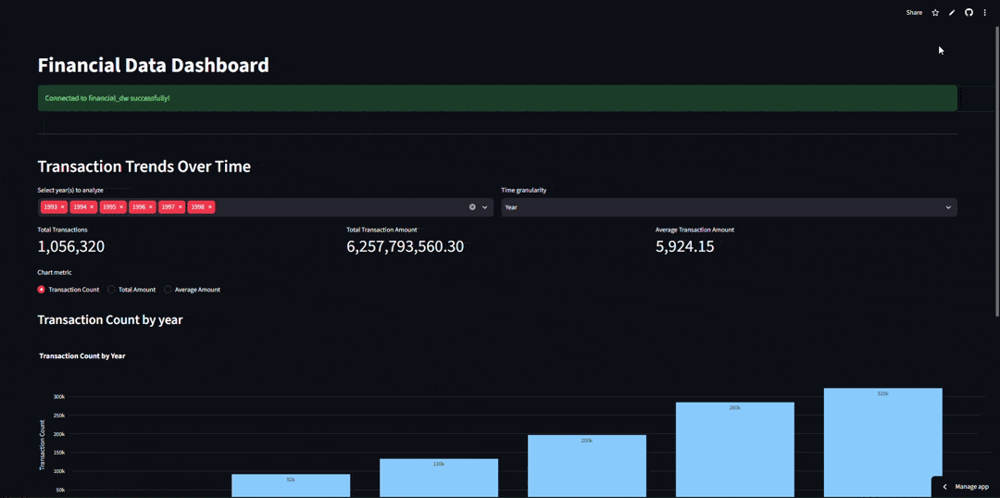

# Financial Data Warehouse

An end-to-end data warehouse project built on the **Prague financial dataset**. Raw banking data is extracted, transformed, and loaded into a MySQL star schema, then explored through an interactive Streamlit dashboard.



---

## Table of Contents

- [Overview](#overview)
- [Architecture](#architecture)
- [Star Schema](#star-schema)
- [Project Structure](#project-structure)
- [Getting Started](#getting-started)
- [Running the ETL](#running-the-etl)
- [Running the Dashboard](#running-the-dashboard)
- [Dashboard Features](#dashboard-features)
- [Deployment](#deployment)
- [Adding the Demo GIF](#adding-the-demo-gif)

---

## Overview

This project demonstrates a complete ETL + BI workflow:

1. **Extract** transactional and reference data from a source MySQL database (`financedata`).
2. **Transform** the data into a dimensional model (date, account, transaction type, district).
3. **Load** the dimensions and fact table into a separate warehouse database (`financial_dw`).
4. **Visualize** the warehouse with a Streamlit dashboard connected to a cloud MySQL instance (Aiven).

The dashboard supports year filtering, time granularity (Year / Quarter / Month), metric switching, CSV export, and summary KPIs.

---

## Architecture

```
Source MySQL (financedata)
        │
        ▼
   ETL.py  (pandas + SQLAlchemy)
        │
        ▼
Target MySQL Warehouse (financial_dw)
   Star schema: 4 dimensions + 1 fact table
        │
        ▼
   App.py  (Streamlit + Plotly)
        │
        ▼
   Deployed Dashboard (Streamlit Cloud + Aiven MySQL)
```

---

## Star Schema

| Table | Type | Description |
| --- | --- | --- |
| `DimDate` | Dimension | Calendar attributes (day, month, quarter, year) derived from transaction dates |
| `DimAccount` | Dimension | Bank account details and statement frequency |
| `DimTransactionType` | Dimension | Transaction type, operation, k_symbol, bank, and account attributes |
| `DimDistrict` | Dimension | District demographics, salary, unemployment, and crime statistics |
| `FactTransaction` | Fact | Transaction amount and balance linked to all four dimensions |

Key relationships:

- `FactTransaction.date_key` → `DimDate.date_key`
- `FactTransaction.account_key` → `DimAccount.account_key`
- `FactTransaction.transaction_type_key` → `DimTransactionType.transaction_type_key`
- `FactTransaction.district_key` → `DimDistrict.district_key`

The full DDL is in [`Dw__schema.sql`](Dw__schema.sql).

---

## Project Structure

```
Data_Warehouse/
├── App.py                    # Streamlit dashboard
├── ETL.py                    # Extract, transform, load pipeline
├── Dw__schema.sql            # MySQL star schema definition
├── requirements.txt          # Python dependencies
├── Dataset finance data.zip  # Source dataset
├── demo.gif                  # Dashboard screen recording (add this)
└── README.md
```

---

## Getting Started

### Prerequisites

- Python 3.9+
- MySQL 8.0+ (local or cloud, e.g. Aiven)
- The source database `financedata` populated from the dataset archive

### Install dependencies

```bash
pip install -r requirements.txt
```

---

## Running the ETL

1. Unzip and import `Dataset finance data.zip` into a MySQL database named `financedata`.
2. Create the warehouse schema:

   ```bash
   mysql -u root -p < Dw__schema.sql
   ```

3. Update the credentials at the top of `ETL.py`:

   ```python
   MYSQL_USER = "root"
   MYSQL_PASSWORD = "your_password"
   MYSQL_HOST = "localhost"
   ```

4. Run the pipeline:

   ```bash
   python ETL.py
   ```

> **Important:** The ETL appends rows and expects empty warehouse tables. Clear the tables before re-running to avoid duplicate-key errors.

---

## Running the Dashboard

Create `.streamlit/secrets.toml` locally:

```toml
[mysql]
user = "your_user"
password = "your_password"
host = "your_host"
port = 3306
database = "financial_dw"
```

Then launch:

```bash
streamlit run App.py
```

The app opens at `http://localhost:8501`.

---

## Dashboard Features

- **Live connection check** to the warehouse with clear error reporting
- **Year multi-select** filter
- **Time granularity** toggle: Year, Quarter, Month
- **KPI cards**: total transactions, total amount, average transaction amount
- **Interactive Plotly bar chart** with selectable metric
- **Data table** of aggregated results
- **CSV export** of the current report

---

## Deployment

The dashboard is designed for [Streamlit Community Cloud](https://streamlit.io/cloud) with a managed MySQL instance on [Aiven](https://aiven.io/).

1. Push the repository to GitHub.
2. Create a new Streamlit Cloud app pointing to `App.py`.
3. In **App settings → Secrets**, paste:

   ```toml
   [mysql]
   user = "..."
   password = "..."
   host = "..."
   port = 3306
   database = "financial_dw"
   ```

4. Deploy. The app connects over SSL (`connect_args={"ssl": {}}`).

---


